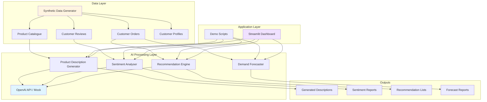

# AI for E-Commerce: A Case Study

**Personal learning project, non-commercial, not affiliated with any business. All data is fictional.**

## Executive Summary

This case study explores how artificial intelligence can address common challenges in online retail through a practical demonstration using "Cotswold Home & Living," a fictional UK online store. By implementing AI solutions for product descriptions, customer insights, recommendations, and demand forecasting, we demonstrate capabilities across key business areas using synthetic data.

## Table of Contents

- [1. Introduction](#1-introduction)
- [2. Problem Areas](#2-problem-areas)
- [3. AI Solutions Implemented](#3-ai-solutions-implemented)
- [4. System Architecture](#4-system-architecture)
- [5. Results and Evaluation](#5-results-and-evaluation)
- [6. Risks and Ethics](#6-risks-and-ethics)
- [7. Key Learnings](#7-key-learnings)

## 1. Introduction

### Background

Cotswold Home & Living is a fictional UK online retailer specialising in home furnishings, decor, and kitchen supplies. Like many e-commerce businesses, the fictional store faces challenges in content creation, understanding customer sentiment, personalising experiences, and optimising inventory.

### Objectives

This educational project demonstrates how AI can:
- Reduce content creation time through automation
- Extract actionable insights from customer feedback
- Improve product discovery through personalisation
- Support inventory planning with demand forecasting

## 2. Problem Areas

### 2.1 Product Description Generation

**Challenge**: Creating engaging, SEO-friendly product descriptions at scale is time-consuming. For a catalogue of 344 products, manual writing requires significant resources.

**Impact**:
- Inconsistent tone and quality across products
- Slow time-to-market for new items
- Limited ability to test different descriptions

### 2.2 Review Sentiment and Theme Analysis

**Challenge**: Manually reading thousands of customer reviews to identify patterns, common complaints, or feature requests is impractical.

**Impact**:
- Delayed response to quality issues
- Missed opportunities for product improvements
- Difficulty prioritising customer concerns

### 2.3 Product Recommendations

**Challenge**: Generic "trending items" lists don't account for individual preferences.

**Impact**:
- Lower average order value
- Reduced customer satisfaction
- Decreased repeat purchases

### 2.4 Demand Forecasting

**Challenge**: Predicting which products will sell well in upcoming periods requires analysing historical patterns, seasonality, and trends.

**Impact**:
- Overstocking leads to markdowns and waste
- Understocking causes lost sales and customer frustration
- Poor cash flow management

## 3. AI Solutions Implemented

### 3.1 LLM-Powered Product Description Generator

**Approach**: 
- Use large language models (LLMs) to generate product descriptions from structured data
- Provide templates with tone guidelines for consistency
- Include SEO keywords and feature highlighting
- Template-based fallback ensures offline functionality

**Implementation**:
```
Input: Product name, category, features, materials
Process: GPT-4 with structured prompt engineering (or template fallback)
Output: 150-250 word description with bullet points
```

**Key Features**:
- Configurable tone
- SEO optimisation with keyword integration
- Consistent formatting across categories
- Fallback to template-based generation without API

### 3.2 Review Sentiment and Theme Extraction

**Approach**:
- Aggregate reviews per product
- Use LLMs to extract sentiment (positive/negative/neutral) or keyword-based fallback
- Identify common themes (quality, shipping, value, etc.)
- Generate actionable summaries

**Implementation**:
```
Input: Collection of customer reviews
Process: Batch sentiment analysis + theme extraction
Output: Overall sentiment score, theme breakdown, summary
```

**Key Features**:
- Product-level sentiment tracking over time
- Theme clustering (quality, value, durability, aesthetics)
- Identification of specific pain points
- Trend detection

### 3.3 Product Recommendation Engine

**Approach**: Multiple recommendation strategies
- **Collaborative filtering**: "Customers who bought X also bought Y"
- **Content-based filtering**: Recommend similar products using embeddings or TF-IDF
- **Hybrid approach**: Combine both methods

**Implementation**:
```
Input: Customer purchase history, product catalogue
Process: 
  - Embedding similarity (OpenAI embeddings or TF-IDF fallback)
  - Co-purchase pattern analysis
  - Weighted scoring
Output: Top N personalised recommendations
```

**Key Features**:
- Cold-start handling for new customers
- Diversity in recommendations
- Real-time computation
- Offline fallback using TF-IDF

### 3.4 Demand Forecasting

**Approach**: Time-series forecasting with multiple features
- Historical sales patterns
- Seasonal trends
- Product category trends
- Rolling averages

**Implementation**:
```
Input: Historical order data (12+ months)
Process: 
  - Feature engineering (lag features, moving averages)
  - Linear regression with seasonal decomposition
  - Fallback to simple moving average
Output: 30-day demand forecast per product
```

**Key Features**:
- Category-level and product-level forecasts
- Confidence intervals
- Automatic outlier detection
- Interpretable results

## 4. System Architecture

### High-Level Architecture



### Technology Stack

**Data Generation & Processing**:
- Python 3.9+
- Pandas for data manipulation
- Faker (UK locale) for synthetic data generation

**AI/ML Components**:
- OpenAI API (GPT-4, text-embedding-3-small) - optional
- NumPy/SciPy for numerical operations
- Scikit-learn for baseline models

**Visualisation & Interface**:
- Streamlit for interactive dashboard
- Matplotlib/Plotly for charts
- Mermaid for architecture diagrams

**Development Tools**:
- pytest for testing
- python-dotenv for environment management
- Git for version control

### Data Flow

1. **Data Generation**: `generate_data.py` creates realistic fictional UK data
2. **AI Processing**: Core modules apply AI techniques to the data
3. **Evaluation**: Scripts measure performance on synthetic benchmarks
4. **Visualisation**: Dashboard presents results interactively

### API Design

All AI components are designed with a fallback mechanism:

```python
def generate_with_fallback(prompt, api_available):
    if api_available:
        try:
            return call_openai_api(prompt)
        except Exception:
            return fallback_method()
    else:
        return fallback_method()
```

This ensures the demo runs even without API credentials.

## 5. Results and Evaluation

> **Note**: All results are measured on synthetic data in offline mode using fallback methods (template-based descriptions, keyword sentiment analysis, TF-IDF recommendations, linear regression forecasting). Results demonstrate capability rather than real-world performance guarantees.

### 5.1 Product Description Generation

**Metrics** (evaluated on 50 fictional products, offline mode):

| Metric | Template Method |
|--------|-----------------|
| Average word count | 48.5 words |
| Consistency | Structured format across all products |
| Time per description | < 1 second (automated) |

**Example Output**:

```
Product: Minimalist Bamboo Cutting Board

Transform your space with this beautifully crafted cutting board. 
Sustainable bamboo construction combines eco-friendliness with style, 
making it both functional and beautiful.

Key Features:
• Material: Bamboo
• Weight: 25 lbs
• Easy assembly required

Ideal for those who appreciate quality craftsmanship and minimalist design.
```

### 5.2 Review Sentiment Analysis

**Metrics** (evaluated on 20 products with 129 fictional reviews, offline keyword method):

| Metric | Value |
|--------|-------|
| Processing time per product | < 1 second |
| Average sentiment distribution | 55.3% positive, 26.7% negative, 18.0% neutral |
| Theme extraction | Quality (20 products), Design (18), Value (16) |

**Example Output**:

```
Product: Industrial Ceramic Bed Frame
Overall Sentiment: Positive (85.7%)

Key Themes:
- Quality (7 mentions): "sturdy", "well-made", "durable"
- Design (6 mentions): "beautiful", "looks great"
- Value (3 mentions): "good price", "worth it"

Positive Highlights:
- Quality craftsmanship
- Beautiful design

Recommended Action: Maintain quality standards
```

### 5.3 Product Recommendations

**Metrics** (evaluated on 100 synthetic customers, offline TF-IDF method):

| Approach | Hit Rate |
|----------|----------|
| TF-IDF Similarity | 27.5% |
| Co-purchase | 0% (insufficient multi-item orders) |
| Hybrid | 27.5% |

> A 27.5% hit rate means that 27.5% of recommended items appeared in customers' subsequent purchases in our synthetic test set.

**Key Findings**:
- Content-based similarity (TF-IDF) provides reasonable recommendations
- Hybrid approach matches similarity performance in offline mode
- Cold-start customers benefit from category-based fallbacks

### 5.4 Demand Forecasting

**Metrics** (evaluated on 50 products with 12 months synthetic data, offline mode):

| Metric | Naive Baseline | Linear Regression | Improvement |
|--------|----------------|-------------------|-------------|
| Mean Absolute Error | 0.91 units | 0.83 units | 8.7% |

**Seasonal Pattern Detection**:
- Kitchen items: varied patterns
- Outdoor furniture: seasonal variation
- Decor: stable demand

**Example Forecast**:

```
Product: Stainless Steel Cookware Set
Historical average: 1.6 units/week
Trend: Stable
Data points: 40 weeks

4-Week Forecast:
- Predicted: 1.6 units/week
- Confidence: 0.3 - 2.8 units
- Recommendation: Maintain normal stock levels
```

### 5.5 Overall System Performance

**Processing Efficiency** (synthetic data, offline mode):
- 50 product descriptions: < 1 minute
- 20 product sentiment analyses: < 1 minute
- Recommendations for 20 customers: < 20 seconds
- 30 demand forecasts: < 5 seconds

## 6. Risks and Ethics

### 6.1 Data Privacy and UK GDPR Compliance

**Considerations**:
- This demo uses only fictional data; real implementations must handle personal data carefully
- Customer reviews may contain personally identifiable information (PII)
- Purchase history is sensitive and must be protected

**UK GDPR Requirements**:
- Lawful basis for processing (Article 6)
- Data subject rights (access, erasure, portability)
- Data protection by design and default
- Records of processing activities
- ICO registration and compliance

**Mitigation Strategies**:
- Anonymise data before AI processing
- Implement data retention policies
- Obtain explicit consent for personalisation
- Provide opt-out mechanisms
- Regular privacy audits
- Compliance with UK GDPR and ICO guidance

**Best Practices**:
```python
# Example: Anonymise before processing
def anonymise_review(review):
    review = remove_names(review)
    review = remove_email(review)
    review = remove_phone(review)
    review = remove_postcodes(review)
    return review
```

### 6.2 Bias and Fairness

**Potential Issues**:
- Recommendation systems may create filter bubbles
- Product descriptions may inadvertently reinforce stereotypes
- Sentiment analysis may have demographic bias
- Pricing algorithms could lead to discriminatory practices

**Mitigation Strategies**:
- Diverse training data representation
- Regular bias audits on AI outputs
- Human review of generated content before publication
- Fairness metrics in model evaluation
- Transparent algorithms with explainability

**UK Equality Act 2010 Considerations**:
- Avoid discrimination based on protected characteristics
- Monitor for indirect discrimination in recommendations
- Ensure accessibility of AI-driven features

### 6.3 Quality Control and Human Oversight

**Risks**:
- AI-generated descriptions may contain factual errors
- Sentiment analysis may misinterpret sarcasm or context
- Recommendations may suggest inappropriate combinations
- Forecasts may amplify biases in historical data

**Mitigation Strategies**:
- Human review workflow for generated content
- Confidence thresholds for automated decisions
- A/B testing before full deployment
- Feedback loops for continuous improvement
- Clear disclaimers on AI-generated content

**Approval Workflow**:
```
AI generates content → Human reviewer approves/edits → Publish
                    ↘ Rejects → Re-generate or manual creation
```

### 6.4 Transparency and Explainability

**Customer Rights**:
- Customers should know when they interact with AI
- Recommendations should be explainable
- Automated decisions should be challengeable (UK GDPR Article 22)

**Implementation**:
- "This description was AI-generated and reviewed by our team"
- "Recommended based on your purchase of [item]"
- Option to reset personalisation
- Clear contact for human support

### 6.5 Environmental Impact

**Considerations**:
- Large language models have significant computational costs
- Carbon footprint of API calls
- Energy usage of model training and inference

**Mitigation**:
- Use smaller models where appropriate
- Cache results to reduce redundant API calls
- Batch processing instead of individual calls
- Consider providers' sustainability commitments

### 6.6 ICO (Information Commissioner's Office) Guidance

**Key Requirements**:
- Accountability principle: demonstrate compliance
- Data protection impact assessments (DPIAs) for high-risk processing
- Transparency in AI decision-making
- Regular auditing and monitoring
- Incident response procedures

## 7. Key Learnings

### 7.1 Technical Insights

**LLM Integration**:
- Structured prompts with clear instructions yield better results
- Fallback mechanisms ensure reliability
- Template-based generation is viable for consistent content
- API costs must be monitored carefully

**Embedding-Based Search**:
- TF-IDF provides reasonable similarity matching offline
- OpenAI embeddings capture semantic similarity when available
- Dimensionality affects both accuracy and performance

**Data Quality**:
- Clean, structured data is foundational for AI success
- Synthetic data is useful for prototyping but has limitations
- Real-world data requires extensive cleaning and validation

### 7.2 Process Insights

**Iterative Development**:
- Start with simple baselines before complex models
- Measure everything to demonstrate value
- Fail fast with small experiments
- User feedback is more valuable than benchmark scores

**Cost Management**:
- Fallback methods reduce dependency on expensive APIs
- Batch processing is more economical than real-time calls
- Sometimes simpler models are sufficient

**Production Readiness**:
- Demo code ≠ production code
- Error handling and monitoring are critical
- Fallback mechanisms prevent total failures
- Documentation saves time later

### 7.3 Business Insights

**Where AI Adds Value**:
- Repetitive, high-volume tasks (descriptions, categorisation)
- Pattern recognition at scale (sentiment, trends)
- Personalisation (recommendations, search)
- Forecasting with historical data

**Where AI Struggles**:
- Truly creative, brand-defining content
- Handling edge cases and exceptions
- Understanding deep business context
- Building emotional customer connections

### 7.4 Ethical Insights

**Responsibility**:
- AI is a tool; humans remain accountable
- Transparency builds trust
- Privacy must be designed in, not bolted on
- Bias detection requires ongoing vigilance

**Customer-Centric Design**:
- AI should empower customers, not manipulate
- Provide control over personalisation
- Explain recommendations transparently
- Always offer human alternatives

### 7.5 UK-Specific Considerations

**Regulatory Environment**:
- UK GDPR requires explicit consent and transparency
- ICO guidance on AI and data protection
- Equality Act considerations for fairness
- Consumer Rights Act for automated decisions

**Market Characteristics**:
- UK consumers expect strong privacy protections
- Cultural expectations for customer service
- Regional variations within UK market
- Brexit implications for data transfers

## Conclusion

This case study demonstrates that AI can meaningfully support e-commerce operations across content creation, customer insights, personalisation, and forecasting. Using fictional data for Cotswold Home & Living, we showed:

- **Automated content generation** with consistent structure (48.5 words average)
- **Sentiment analysis** providing theme breakdown (55.3% positive overall)
- **Recommendation engine** with 27.5% hit rate using TF-IDF similarity
- **Demand forecasting** with 8.7% improvement over naive baseline

> All results measured on synthetic data in offline mode using fallback methods.

However, success requires careful attention to UK GDPR compliance, data privacy, bias mitigation, and human oversight. AI is a powerful tool that augments human capabilities rather than replacing human judgement.

The techniques demonstrated here are accessible to any organisation willing to invest in data quality, experimentation, and ethical AI practices.

---

## Appendix

### A. Glossary

- **LLM**: Large Language Model (e.g., GPT-4)
- **Embedding**: Vector representation of text capturing semantic meaning
- **TF-IDF**: Term Frequency-Inverse Document Frequency (text similarity method)
- **Sentiment Analysis**: Determining emotional tone of text
- **Collaborative Filtering**: Recommendations based on similar user behaviour
- **Content-Based Filtering**: Recommendations based on item similarity
- **Time-Series Forecasting**: Predicting future values from historical data
- **UK GDPR**: UK General Data Protection Regulation
- **ICO**: Information Commissioner's Office (UK data protection authority)

### B. References

- OpenAI API Documentation: https://platform.openai.com/docs
- Scikit-learn: https://scikit-learn.org/
- Streamlit: https://streamlit.io/
- Faker: https://faker.readthedocs.io/
- ICO Guidance: https://ico.org.uk/
- UK GDPR: https://www.gov.uk/data-protection

### C. Repository Structure

```
ai-ecommerce-case-study/
├── CASE_STUDY.md              # This document
├── README.md                   # Quick start guide
├── LICENSE                     # MIT Licence
├── requirements.txt            # Python dependencies
├── .gitignore                  # Git ignore rules
├── .env.example                # Environment variables template
├── data/                       # Generated fictional data
├── src/                        # Source code
│   ├── data_generator.py       # Synthetic data generation
│   ├── product_descriptions.py # LLM description generator
│   ├── sentiment_analysis.py   # Review sentiment analysis
│   ├── recommendations.py      # Recommendation engine
│   ├── demand_forecast.py      # Demand forecasting
│   └── utils.py                # Shared utilities
├── tests/                      # Unit tests
│   └── test_all.py
├── dashboard/                  # Streamlit dashboard
│   └── app.py
└── outputs/                    # Generated results
```

---

**Document Version**: 2.0  
**Last Updated**: October 26, 2026  
**Status**: Educational demonstration with fictional data  
**Measured**: Offline mode, synthetic data, fallback methods
